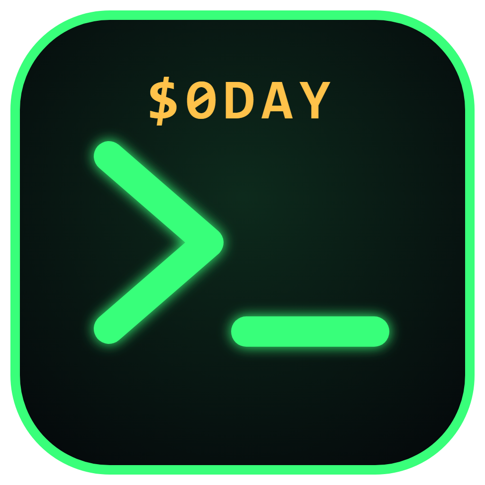

# Zero Day Hustle

A trading game set in the hacker underground. You start with $2,000, a debt to the Fixer that grows every day, and no last day. Buy low, sell high, stay off the radar, and walk away while you still can.



## Play in the browser (and on iPhone)

**https://trashpanda-549.github.io/zero-day-hustle/**

It runs on any phone or computer. On an iPhone or iPad, open the link in Safari, tap Share, then **Add to Home Screen**: it then opens full screen like an app and keeps working offline.

## Download

Grab the latest build from the [Releases page](../../releases):

| Platform | File | Notes |
| --- | --- | --- |
| Windows | `ZeroDayHustle-<version>-windows.exe` | Portable, no install. SmartScreen may warn because the app is unsigned: choose More info, then Run anyway. |
| Android | `ZeroDayHustle-<version>-android.apk` | Android 7 or newer. Allow "install unknown apps" when asked. |
| Mac | `ZeroDayHustle-<version>-mac.dmg` | Unsigned: right-click the app and choose Open the first time. |
| iPhone | `ZeroDayHustle-<version>-ios-unsigned.ipa` | Unsigned, so it only installs through a sideloading tool that signs it with your own Apple ID. For most people the browser version above is the easier way. |

## How to play

- A career has no fixed end. The day counts up for as long as you keep going, and it ends one of two ways: you are taken down (the NSA, or dysentery), which pays nothing at all, or you **retire** from the Bunker, which sells up everything you own and puts the total on the hall of fame. You can retire from day 7 on, as long as you owe the Fixer nothing.
- Every extra day is worth more and costs more. The markets keep growing, so a day near the end of a long career is worth about three times a day at the end of the first month. But past day 30 the pressure climbs too, and it goes on climbing until day 150: the law stops forgetting you (your Heat settles back up to a floor that rises to 38%, two points under the FBI's attention, and nothing in a bag will take it lower), rival crews start coming for you without being provoked, raids on the Bunker and run-ins on the street get likelier, bigger crews turn out, and the Fixer's rate climbs from 8% a day towards 14% (he stops adding to a debt once it reaches eight days of a strong player's takings, so it never becomes a number you could not read or clear — but you cannot retire owing him anything, so leaving it is how a career gets stuck). After day 150 none of it gets any worse, and nothing ever grows past what the fight screen and the money column can hold. The day line says what the street calls you: KNOWN, WATCHED, HUNTED, MARKED.
- So the whole game is one decision, over and over: press on for another day, or go home and bank it. It is the same decision as a deep run, played across a whole career.
- Retiring pays out your cash, your cold wallet, everything you are carrying and everything in the stash (a fence pays 60% of what the goods are worth) and the whole garage at the shops' trade-in rate. It pays XP for every day you stayed in, on top of what finishing always paid. The Bunker and everything built in it, your skills, your XP, your gear, your lock picking and your weapon skills all belong to the save and are waiting for the next career.
- The hall of fame keeps the same careers ranked two ways, because they are no longer the same length: the biggest retirement, and the best net worth a day. It is on your record screen at any time. Entries from the thirty-day game (1.29 to 1.35) and from the economy before the 1.29 crash are kept and listed separately underneath, and so are the careers that were taken down, which have no number next to the name.
- **Retiring has several endings**, and which one you get is decided by how the career was played, not by the money alone. The money matters (an island and a satellite uplink at the top end, bus fare and a burner at the bottom), but so do the days you lasted, your Heat on the last morning, how many fights you had, whether you were ever arrested, how much of the Bunker you built, whether you ever cleared the Fixer in full, whether a cat moved in, and whether your net worth a day beats the best on your own board. Each ending has a short epilogue, which is shown in the send-off and recorded with your hall-of-fame entry so it can be read again. Being taken down has its own send-offs: one for a career the law had nothing on, one for a career rich enough to be worth seizing in daylight, and one for dysentery.
- **Your old careers haunt the new ones.** A career that ended is a person, and later careers run into them: a line on a market's news board about somebody who walked away with $12,000,000, a street contact who tells you not to get ideas, a rival crew working off a retired operator's playbook, a cache deep in a building holding gear with their name inked inside the collar, a file in a records room nobody closed, and the biggest retirement on the board, which is a number you can pass and take home. A career meets a handful of them at most, and never the same one twice. The ones who were taken down leave a different kind of trace, and it is not a flattering one.
- Ten goods, from Warez up to Zero-Days, with prices that change every day. News events make some scarce and others dirt cheap.
- No market can move unlimited weight. Every unit you sell in one place pushes its price down and every unit you buy pushes it up, each market only has so much in stock a day, and the amount picker shows the total, the average and what the last unit goes for before you commit. A market you flooded is still soft the next morning (half of the move is left each night), so spread your deals around. While you are across town, a market you moved drifts back a little with every trip you make, so with enough trips in a day you can come back and deal again: that is what a ride is for. Stock does not come back until morning. Markets start small and deal bigger every day of the month; street goods (Phishing Kits and cheaper) trade everywhere from day one, and the dearest goods are not for sale at all in the first week. Past the first month they keep growing, but far more slowly: about twice the day-30 size by day 60, three times by day 200 and three and a half by a year in, so a long career always pays better than a short one without ever running away.
- Tunnel between the locations. Travelling does not end the day: you get six trips a day, prices stay put until you sleep, and only sleeping at the Bunker starts a new day. The trip home is always free.
- The Hackerspace is home: pay down or borrow from the Fixer, and park cash in the cold wallet where it earns interest and can't be phished. The wallet pays its full rate on the first $250,000 and a third of it on anything above, and a night's interest never beats half of what a strong player clears in a day, so a long career cannot live on it.
- Freelance jobs use up goods you hold on a job. If the job works it pays more than selling them (though never as much as a scarcity spike would); if it fails the goods are burned and your Heat jumps. A job never asks for more than a market deals in that day.
- Money comes slowly: expect to be poor for the first week, comfortable by the middle of the first month and rich only after it. A careful trader is worth a few million by day 60 and should think hard about walking away; somebody playing it perfectly is worth tens of millions by then and hundreds of millions if they survive two hundred days. The cold wallet is a safe place to keep money, not an engine: a night's interest never beats half of what the street pays in a day.
- The long game is what you spend it on, and none of it gets dearer with the days: the whole Bunker built to its top level is about $18,400,000, the best helicopter $500,000, and the full skill tree needs a level 36 career. In the old thirty-day game almost none of that was reachable. Over a career it is the thing that keeps you in one more day.
- A ride gets you more trips. On foot you get six a day; whatever you are riding adds its hops on top, from +1 for a Thrift Store Skateboard (Three Wheels) or the Unicycle of Shame up to +20 for the Black Helicopter (It Was Never Here), which makes 26 stops in a day before you have to go home and sleep. There are 29 rides in three shops: 404: Brakes Not Found at the Campus Lab (skateboards, scooters, bikes and three unicycles, +1 to +5, $1,200 to $70,000), Grand Theft Otto's in Paste Alley (mopeds, a ride-on lawnmower, cars, vans and an ice cream truck, +6 to +13, $85,000 to $300,000) and Get to the Choppa! on the roof of the Con Hallway (a lawn chair with weather balloons, a jetpack, a blimp and helicopters, +14 to +20, $300,000 to $500,000). Extra trips pay because the markets you have already dealt in drift back while you are elsewhere, but with diminishing returns: the usual jumps (a skateboard in the first days, a bike around day 9, the van in the middle of the month, an aircraft after day 18) pay for themselves in five to eight days, fuel included, while trading up one rung at a time near the top does not. Skipping rungs is the smart buy, and the shops now say so for you: under every ride, each shop and the Garage at the Bunker show how many hops it would add over the one you are on, what that is worth a day once its fuel is paid, and how many days it takes to earn its price back.
- You ride one at a time and can own four (up to seven once the Garage at the Bunker is built up). Buying one puts you on it straight away with a full tank; the one you came on is traded in for 40% of its list price or sent home to the garage at the Bunker, where you swap between them. Swapping moves today's trips by the difference in hops, and hops you have already used stay used. Any ride shop buys the one you arrive on. Rides belong to the career: every new one starts on foot, and the whole garage is sold up when you retire.
- Anything you pedal costs nothing to keep. Engines and aircraft take a tank of fuel each day you ride them, from $700 for the Mobility Scooter (Overclocked) to $20,000 for the Black Helicopter, paid when you wake up; if you cannot pay, it adds no hops that day. The loud ones also add 1 to 5% Heat each day you fuel them. Some carry goods for you, from 10 in a scooter's basket to 150 in a twin-rotor, and you cannot get off one while it is holding more than you could carry without it.
- It opens on the studio ident: TrashPanda's TrashTech, drawn in ASCII in the game's neon colours, for about a second and a half. A tap, a click or any key cuts it short, and then the loading screen starts where it always did. On a slow machine it is the first thing on screen while the rest of the page is still coming up.
- The game opens on a start menu. You can keep up to five save files, each with its own levels, gear, achievements and run in progress; the Menu button takes you back to switch or start another.
- The Android app runs full screen, like the desktop one: the status bar and the navigation bar are hidden, so the game has the whole screen, and it still keeps clear of a camera cut-out. Swipe in from an edge and the bars come back for a moment, then hide themselves again.
- It also plays on a tiny handheld screen. On a screen no taller than 260 pixels, like a 320 x 170 pocket machine, the game is dealt out over five screens with one job each &mdash; the market, you, the jobs, the log, and what you can do &mdash; with the day, where you are and your cash across the top of every one and the keys that work along the bottom. The number keys are the interface: 1 to 9 (and 0) take the numbered thing in front of you, left and right change screen, Escape comes back to the market, and T, I, G and M open travel, your inventory, your gear and the Bunker's rooms. A buy is three keys and travelling is two. Nothing on a screen is smaller than 11 pixels and the figures you act on are 17, so it is read at arm's length; the fight screen is drawn edge to edge at one screen pixel to the big pixel, and the decoration that costs the most to draw is off at that size.
- You earn XP and levels that carry over between runs. At level 10 you can join one of four syndicates, each with a permanent perk.
- Every level-up pays one skill point, spent on a tree of twenty routines: programs, exploits, daemons and street tricks, in five branches that pull against each other. ICEbreaker is fights, Entry is locks and break-ins, Arbitrage is freelance work and money, Noise Floor is Heat, and Meatspace is your body. The tree is on your record screen (and straight off the main screen while a point is unspent), one branch at a time, four routines deep.
- A branch is a line: each routine needs the one before it and a level of its own (2, 6, 12 and 20), and costs 1, 1, 2 and 3 points. The whole tree costs 35, which a level 36 career has: before that it is a build, not a shopping list. Routines belong to the save and carry over between runs, like XP and your lock picking. If you want the points back, reflashing the kit refunds all of them for $25,000 and 10% Heat.
- Fifteen of them are daemons, always running: +3% to hit, 8% of their attacks missing, 5% less damage after armour, +2% Health a night and medkits healing 10% more, quieter picking and better odds at a lock and on the way out, freelance jobs that land more often and pay more, a better cold wallet and a cheaper Fixer, 15% more off anyone you beat, 10% off every gain of Heat and 3% more off every night. Every number is modest on purpose: a full build is worth a few percent everywhere, not a different game.
- Five of them are scripts: commands that appear on the fight menu when you can fire them, each once a fight. Overclock spends a turn and 12% OpSec for +20% to hit for the rest of the fight. Killswitch drops two of them for 15% OpSec. Burn Notice takes 10% off your Heat and costs them their turn. Adrenal Shunt gives back 20% Health with no medkit. Dead Hand walks you out of any fight for 20% OpSec. Second Wind is the odd one out, a daemon that catches you once a fight on 10% Health instead of letting you go down.
- Each syndicate has its own line of eleven missions, three of them break-ins, given by a handler, built from what that crew is about: Ghost Shell wants you unseen, Black Ledger wants money made, Null Sector wants cargo moved and Red Team Zero wants fights won. Each line ends with a breach of a rival crew's core. Missions pay far more XP than anything else, plus cash and gear, and progress carries over between runs. After the last one the crew hands out repeatable standing orders that pay more XP the higher your level. The mission you are on is always on screen, in full, directly above the two drop-downs you use most (PRODUCTS and the LOCAL BBS): the crew's name and how far along you are on one line, then the mission, what it wants, what it pays and the way to the briefing.
- Some missions are break-ins, played in four stages at one place: case it or go in blind, get through the lock, do the job inside (hack something, rob the place, or leave a device behind), and get out clean or get out fast. What goes wrong early follows you in: every miss at the lock, a forced door and clumsy work inside all raise the site's Alert, a full meter trips the alarm (Heat, and usually site security, the law or a rival crew to fight), and the Alert decides how likely you are to slip out unseen. A forced door also means less time inside and a smaller haul; a quiet entry and a clean exit pay a bonus. A break-in that goes wrong is not lost: the place needs a night to calm down, then you can try again.
- Each syndicate line has three break-ins of its own, and they come back as standing orders. Street contacts hand them out as gigs from the first day, and about one Local BBS board in three has one posted: somebody wants a USB Dropper, a Rogue AP or a burner phone left somewhere it should not be. A device you leave behind sends a little money home every night for three to five nights, unless you only taped it up and somebody finds it.
- Locks come in five kinds, from a cheap padlock to a server-room maglock, and the right tool matters. Lock Picks open mechanical locks quietly and snap; a Bump Key is fast on cheap locks, loud, useless on security pins, and wears out; a Pick Gun is good on any mechanical lock; an RFID Cloner is the only quiet way past a badge reader or a maglock; a Crowbar opens most things, loudly. The black market sells them, junkies and beaten crews sometimes have one, and you start each run with three picks. There is always a bent paperclip.
- Lock picking is a skill, from level 1 to 10, and it stays with your save between runs like XP. Opening a lock teaches more than a miss, and a harder lock teaches more. Skill, tool and lock decide the chance to open it, the chance the tool breaks and the noise a miss makes, and you are shown all three before you try. A practice board in the Bunker gives six tries a day and teaches up to level 4. Your level is on the main screen and in your record.
- There are 72 achievements, and each pays XP when you earn it. One is a secret, and earning it gets you an invitation from a fifth, hidden syndicate with its own perk and its own line of missions. It is the one crew you can leave another crew for.
- Now and then a junkie is waiting where you surface, selling gadgets, medkits, ammo, weapons, gear or goods for 25 to 45% of the shop price. Each one carries different things, and they are gone once you walk on.
- Not everyone waiting is selling. On about one trip in ten, street muscle jumps you where you surface. They are there in person, so their hits always land on your Health, and half the time they get the first swing in. Speed gear makes the ambush less likely to land. Fight, run, pop smoke, or hand over a fifth of your cash.
- Big deals raise your Heat (big next to what the markets move that day, so a deal that goes unnoticed in week four turns heads in week one), and Heat decides who hunts you: the police, then the FBI, then the NSA. Police and FBI seize your goods, fine you and cost you days. The NSA ends the career, with no score.
- Fights play out on a side-on battle stage with a backdrop for wherever you are: the street, an alley, a market, a wall of server racks, the Bunker with its door kicked in, or the inside of a rival crew's system. The hostiles stand on the left, staggered in depth, and each faction has its own people: beat cops and riot officers, FBI agents and tactical teams, NSA operators and cleaners, two sorts for every rival crew, street muscle with whatever they brought, and one much bigger figure holding a crew's core. You stand on the right in the gear you are wearing, holding the weapon you own.
- Under the stage are windows for who is left standing, the commands, and your Health, OpSec, weapon and ammo, with a marker for whose turn it is. Gadgets, medkits and ammo sit together under Items, the prison pocket opens a list of its own, and aimed moves ask who to aim at. Everyone steps up to act, and what a move looks like comes from the weapon in your hands: a club swipes, a sledge or a hammer winds up and comes down overhead, a blade cuts through and carries on (two cuts if it swings twice), a shuriken leaves your hand spinning, a pistol kicks and throws a casing, a shotgun fans pellets, an SMG or a gatling climbs through a burst, a sniper or a rail gun charges and lets go one heavy beam, a launcher lobs a shell, and a flamethrower or a plasma rifle sprays a cone. EMPs are thrown, hacks arrive as bolts of code. A hit that lands stops the picture dead for a fraction of a second, flashes, shakes the stage and throws sparks, and the heaviest hits lean the camera in; the ones who miss duck, step aside or turn it away with what they are holding; the beaten are knocked off their feet, land in the dust and fade, or come apart over the wire, and the ones standing next to them flinch. Numbers bounce off whoever is hit, and a win ends with a results window that adds up the cash, XP, Heat and anything they dropped.
- It all works by touch or by keyboard: arrow keys or W and S move the pointer, Enter or Space picks, Escape or Backspace goes back. Tap the stage or press Enter to skip an animation, and the SPEED button in the corner plays every fight at double speed. The normal speed is brisker than it was: fights at x1 now run about a fifth quicker, with less dead air between moves. If your system is set to reduce motion, the screen shake, the flashes and the camera lean are left out and everything plays at the fast speed.
- Heat cools when you sleep, and there are things you can carry that bring it down, used from the Inventory or the Lower Heat button, never in a fight. A Burner Phone takes off 10%. A Fingerprint Remover takes off 25% and costs 15% Health. A Log Wiper takes off 30% while only the police want you, 20% from the FBI and 10% from the NSA, and one time in five it trips an alarm and adds 8% instead. Those three are fast fixes, and you get two of them a day: the first works in full, the second at half strength. A Lie Low Kit takes off 20%, but only at the Bunker with three or more trips left, and it uses up the rest of the day. Decoy Traffic cools an extra 10% a night for three nights. A No-Logs VPN halves everything that raises your Heat for two days, the day you switch it on and the next. The Fake ID still takes off 40% in one go, any time, at full strength.
- The black market sells them, but each market only gets three of the six kinds a day, one of each, and charges 25% more when the FBI wants you and 50% more when the NSA does. Junkies sometimes have one, and so do rival crews you beat. They take no room on your Drive; like other gadgets you can carry two to four of each.
- When the law has you cornered you can also use your prison pocket: it hides up to six small goods (not Rogue APs, Phishing Kits or Botnet Hours) through a search, an arrest or a drive wipe, and costs you the turn. About one time in three, some of them do not come back out. Stuck goods cannot be sold, used or moved until the street doc at the black market removes them, for $2,000 (more later in a run, and on the Fixer's tab if you are short), and he patches you up to full Health while he is in there.
- Goods the doc has removed sell for 20% less from then on, with a tag that reads "discount because reasons". They stack with clean ones of the same kind and are sold separately.
- Do not sleep on stuck goods. The first two nights you only heal 15%; from the third it is dysentery, which costs Health and trips every morning; the fifth is a last warning, and the sixth night you die of dysentery, which ends the career with no score. Every night tells you how many you have left.
- The Bunker is your hideout. Stash goods there to free up your drive, keep spare gear in the locker, and sleep to end the day and heal. Rival crews can't attack you at home, but the police, the FBI and the NSA can raid it whether you are in or out, including while you sleep, and they seize the stash.
- The Bunker is also a base you build up, and it belongs to your save: it is still there on your next run. The Bunker screen is a cutaway of the place with a room for each of fourteen stations. Tap a room to use it or to build it up; the Base button lists them all. The stash, the gear locker, the bunk, the garage and the lock board are stations too, at level 1 from the start, and a tap on their room opens them as before.
- Every station has three or four levels. A level lists exactly what it needs: cash, things you hand in (goods from your drive or the stash, ammunition, gadgets, medkits, spare gear of a given rarity, sometimes the weapon you carry), and sometimes your level, a skill or another station. What you hand in stays handed in, so a level can be paid for a bit at a time, across runs, and none of it comes back. Then it takes one to four nights to build, one build at a time (two once the power is up to it), and the station works as before until it is done.
- What they do: the Stash holds 300 goods and up to 800; the Gear Locker 20 pieces and up to 48; the Bunk heals 35% a night and up to 60%; the Garage holds 4 rides and up to 7, with fuel up to 15% cheaper; the Lock Board gives 6 tries a day and up to 12, teaches to level 4 and up to 7, and gains a badge reader and a maglock to practise on. The Med Bay patches you up once a day for nothing, later makes a medkit from Cracked Accounts and gets stuck goods out at home. The Workshop presses rounds into the next grade up, makes lock picks, bump keys and pick guns from goods, and tunes the weapon you carry for up to +5% to hit. The Server Closet turns out a few cheap goods a night into the stash. The Jammer makes raids on the Bunker up to 40% less likely and cools a little more Heat each night. The Intel Board gives one to four rumours a day about prices elsewhere, right 70 to 95% of the time. Power runs the rest and costs $40 a night for each level that needs it; if you cannot pay in the morning, everything with a plug is off that day. A cat moves in if you make the place acceptable. The Trophy Wall adds up to 6% XP.
- The Range is where you practise with the weapon you carry. A session is five shots at a target while the sight drifts (tap or press the button when it crosses the middle, or skip the aiming for an average score); with a gun it burns 12 rounds, later 9. Sessions are limited to two to four a day. Practice builds a skill for each kind of weapon (blunt, blades, firearms, military hardware), from 0 to 10, kept with your save: each level adds 1% to your chance to hit with that kind, and with guns each level gives every round a 2% chance of not being spent. The first Range takes blunt weapons and blades to level 3; better ones add firearms and military hardware and teach to 5, 7 and 10, and the last has moving targets and an entry drill worth +8% on your first volley in any fight. Real fights teach too, slowly.
- Deep runs are dungeons: rooms one after another, several floors down, ending in a boss room worth having. They come in two kinds on one engine. A **building** is physical: the meter is Alert, damage lands on your Health, loot goes straight onto your drive so your bags decide what comes out, a locked way on is a real lock opened with entry tools and your lock picking skill, and at 100% Alert site security, the law or a rival crew turns up on the battle screen. A **network dive** happens from a terminal: your body never leaves the booth, so the meter is Trace, damage lands on OpSec alone, the hostiles are ICE and black-ice constructs in a hacking-only fight, a locked way on is a crypto gate opened with a Zero-Day, a Logic Bomb or your proxy chains (or brute-forced for a lot of Trace), the law barely notices, and the haul is data that uploads to the Bunker stash when you get out, so the Stash's level decides how much comes home, not your backpack.
- Rooms are dealt from tables with the address's own seed, so a run keeps its shape across a save and reload while the rolls inside a room stay live. There are caches (goods, cash, ammunition, a gadget, sometimes a piece of gear), guards and watchdogs you can take on or creep past, locked doors and crypto gates, traps and countermeasures you can disarm or walk into, a quick-and-loud or slow-and-quiet choice, a break room or quiet subnet to patch up in, paperwork that sometimes holds another address, and empty rooms so the pacing varies. Deeper floors are longer, nastier and worth more.
- You get in with an address. The Intel Board at the Bunker turns one up most mornings (and from the Wall of Monitors it reads the first floor for you), a broker on the street sells one now and then, you find them in other people's paperwork, and from the Deep run button you can spend a trip going looking. You can hold three at a time and each goes cold four days after you get it. A dive can also be run from your own rig at the Bunker once the Server Closet is built.
- Going in costs a trip and so does each floor down, so a deep run is most of a day. You can walk out at any room with everything you are holding, which is the real decision: press on for the floor below, or stop while you still have it. Reach the bottom and beat what is in there and it pays cash, a lot of XP, a lot of goods and a piece of gear whose rarity follows how deep the run was. If it goes wrong, a building takes back the goods and cash you picked up in there (anything you brought in is still yours) and a dive loses the whole upload, but never your Health.
- Money from a deep run is deliberately modest: a four-floor run around day 12 is worth a little less in cash and goods than the same trips spent trading. What it is for is gear, XP, and the goods, ammunition and gadgets the Bunker's stations want. Every number a deep run uses is in one table (DUN) in the source.
- Rival syndicates try to rob you, and once a day you can raid one of their nodes for loot. Every raid makes that crew angrier.
- When cornered you can fire a weapon, throw an EMP, counter-hack through your proxies, burn a Zero-Day, run, wipe your drive or pay them off. Weapons and gear come from the black market at the Tor Bazaar and the Datacenter Dock.
- Weapons come in four kinds. Blunt weapons are quiet and can stun, blades are silent, firearms are loud, and military hardware is very loud. The gun store at the Strip Mall sells the first three but runs a background check on firearms; the arms dealer at the black market sells firearms at a markup and military hardware with no questions asked.
- Firearms and military hardware use ammunition, one round a shot. There are five kinds, from Bargain Bin Bullets (5% worse) to Aimbot Rounds (25% better at hitting). Out of ammo, a gun is just a club.
- Ctrl+Alt+Drip at the Strip Mall sells clothing, backpacks and body armour, with two items for every gear slot each day.
- You have two bars to protect. Shooting, EMPs and running put your Health at risk; hacking puts your OpSec at risk. Lose either and you go down. An armoured vest cuts Health damage, and a street doc at the black market patches you up.
- Sleeping cools your Heat and restores Health and OpSec. Medkits heal you any time, even mid-fight; you start each run with two, and with a basic item in every gear slot except the face and the coat.
- Gear for eleven slots (head, face, shirt, body, coat, backpack, wrist, hands, pants, feet, deck) boosts your stats and comes in five rarities: Common, Uncommon, Rare, Epic and Legendary. Rival crews drop it, the black market sells it, and it stays with you between runs.
- What you can carry depends on what you wear. Your own drive holds 60; the rest comes from the backpack on your back and from anything with pockets (pants, jackets, coats, even shirts). There are eight kinds of bag, from a Fanny Pack to a Hiking Pack, and the rarer the bag the more it holds: a Common one 14 to 32, a Legendary one 56 to 128. Every item says what it holds, the Gear screen adds it all up, and the amount on your Drive is shown in the colour of your backpack's rarity. You cannot take off a bag or a pair of cargo pants while you are carrying more than you could without them.
- Your avatar shows all of it. Pick a skin tone, hair and streak from the Gear screen. It wears your gear (Epic pulses, Legendary shimmers and sparks), carries your weapon and gadgets, and stands in front of wherever you are. It gets bruised and bandaged as Health drops, glitches as OpSec fails, and is lit by police lights, a Fed searchlight or an NSA crosshair as Heat climbs. Your syndicate leaves its mark, and cyberware appears at levels 8, 9, 20, 25 and 30.
- Nothing counts unless you retire. Get taken down and the career is over with no score at all; retire from the Bunker and your cash, your cold wallet, your goods, your stash and your garage are all added up, minus whatever you still owe (and you cannot retire owing the Fixer anything). Either way the career leaves a mark: the send-off you earn is written down with its epilogue, and later careers will run into whoever you were.

## Terminal version

There is also a text-only version that needs nothing but Python 3. It is the original, simpler game, without freelance jobs, levels or syndicates:

```
python hustle.py
```

## Building from source

The game is a single page, `www/index.html`, which also runs in any browser. The desktop apps wrap it with Electron and the Android app with Capacitor.

```
npm install
npm start            # run the desktop app
npm run dist:win     # build the Windows .exe into dist/
npm run dist:mac     # build the Mac .dmg (on a Mac)
```

For Android, with Java 21 and the Android SDK installed:

```
npx cap add android
npx cap sync android
node tools/android-fullscreen.mjs   # keeps the hidden system bars from coming back for good
cd android && ./gradlew assembleDebug
```